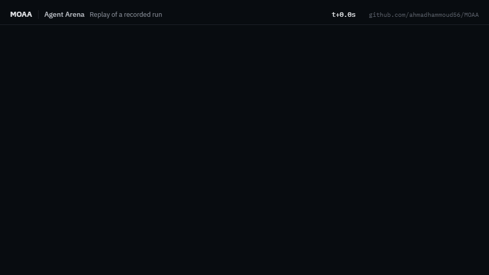
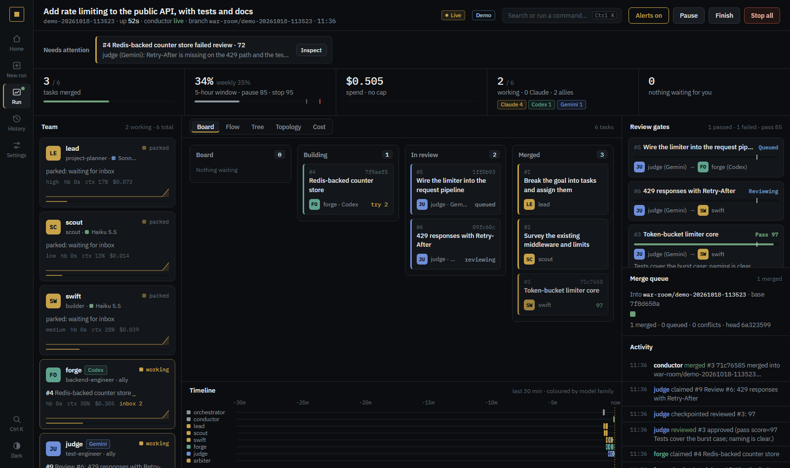

# MOAA: Mother of All Agents

[](https://github.com/ahmadhammoud56/MOAA/actions/workflows/ci.yml) [](https://github.com/ahmadhammoud56/MOAA/releases) [](LICENSE)

**Agents compete in an arena; the winners join a 60-role council that cross-checks your answers.**

MOAA turns Claude Code into a team. A **Specialist Council** of 60 role agents, each with its own model and effort
level, works a problem in parallel and checks the results against each other before you see an answer. In the
**Agent Arena**, agents compete and a blind judge scores them, and agents that keep winning are **forged** into
permanent council members.

## Try it in Claude Code

```
/plugin marketplace add ahmadhammoud56/MOAA
/plugin install moaa-core@moaa
```

Restart Claude Code, then:

```
/specialist-council:specialist-council  Is 221 prime? Factor it.
/agent-arena-mode:judge --quick -- Write fib(n) with fib(1)=fib(2)=1 and give fib(20).
```

`moaa-core` installs the council, the arena and moaa-catalog. For the whole setup (about 90 pinned third-party
plugins, standalone skills and MCP servers), use the installer:

```bash
git clone https://github.com/ahmadhammoud56/MOAA.git && cd MOAA
./install.sh              # macOS / Linux / Git Bash  (Windows PowerShell: .\install.ps1)
```

### Staying up to date

- **Marketplace install:** run `python scripts/install.py --auto-update` once in a clone, or turn it on in
  `/plugin` > Marketplaces > moaa > Enable auto-update. Claude Code then refreshes MOAA in the background and says
  `Plugin updated ... Run /reload-plugins`.
- **Clone install:** `python scripts/install.py --update` pulls, reinstalls with your profile and mode, and prints what
  changed.
- **Either way:** at session start, moaa-catalog checks GitHub's latest release once a day and tells you when a newer
  one is out, with the exact command (silent offline; `MOAA_NO_UPDATE_CHECK=1` turns it off). To get an e-mail per
  release, use Watch > Custom > Releases on the GitHub repository.

New here? The [5-minute guide](docs/GETTING_STARTED.md) walks through every part, and `/moaa-catalog:moaa-help`
answers "what can MOAA do?" from inside Claude Code.

## What a council run looks like


A real run, replayed from its transcript and compressed from 44 s. The analyst factors 221 with Fermat's method; a
forged arithmetic checker (an arena agent that scored 97 and 95 in two validated runs) uses trial division; the
coordinator checks that they agree:

```
221 is not prime. 221 = 13 × 17.
Both workers agree. Check: 13 × 17 = 221, and 15² − 2² = 221. 13 and 17 are prime.
```

That loop is what MOAA is built around:

```
 task ──► Specialist Council (60 roles, per-role model + effort) ──► verified answer
            ▲                                      │
            │ forge (≥2 validated runs, every      ▼
            │ score ≥ 85, spread ≤ 10)      Agent Arena (8 modes, judge + validator)
            └──────────── library of winning agents ◄─┘
```

An arena run, replayed from its transcript: three contestants work in parallel, a blind judge scores them and a
fresh validator checks the winner (real run, 233 s, compressed):



## What's inside

| Plugin | What it does |
|---|---|
| **Specialist Council** | 60 role agents (debugger, statistician, security reviewer, FEM specialist, …) with per-role model and effort presets ([MODELS.md](MODELS.md)). Split, ensemble or hybrid teams, one integrated and verified result. |
| **Agent Arena** | Eight modes: judge, tournament, league, swarm, cascade, red team, evolution and synthesis. Every judged result goes to a local library; proven agents are forged into the council. |
| **War Room** | Several real Claude Code sessions on one big job, with a task board, review gates on a different model, a merge queue and a live local app. [Zero-token demo](docs/GUIDE.md#try-it): `python plugins/war-room/warroom.py demo`. |
| **Allies** | Hands bounded tasks to Codex, Gemini, Kimi, DeepSeek or a local OmniRoute gateway, each on its own account. Read-only by default; writes land on their own branch. |
| **Strata** | Layered long-term memory in local SQLite (raw sessions, notes, project scenes, your profile), recalled at session start. **Context handoff** near a full context window, a Karpathy-style **LLM Wiki** (`/strata:wiki`) and a **findings graph** with a grounding check (`/strata:graph`). |
| **prompt-refiner** | Turns every prompt into a clear brief before Claude works on it, asks about ambiguous points with concrete options, and hands the brief to every subagent. |
| **moaa-catalog** | Skills on demand: big skill packs stay installed but disabled, a prompt hook names the one skill a task needs, and a daily check tells you when a MOAA update is out. |
| **More skills** | `/specialist-council:long-task` (brief, progress file, evidence review, resume), `/agent-arena-mode:karpathy-loop` (keep only changes that move a number), `/agent-arena-mode:effort-trial`, and Anthropic's automation recommender. |

### Always on, no commands

Four things run on their own once installed, and each has an off switch:

- **Prompt to brief** (prompt-refiner): Claude rewrites each new request as a brief (goal, deliverables, constraints,
  acceptance checks), asks about anything material with 2-4 options, saves the brief to `.briefs/`, and gives
  subagents the brief instead of your raw words. Short replies, slash commands and already-detailed prompts pass
  straight through. Off: `py plugins/prompt-refiner/refiner.py off`, or start a prompt with `raw:`.
- **No more compacting** (strata): at about 85% of the context window Claude stops at a safe point, writes
  `HANDOFF.md` and `CONTEXT.md` to `.claude/handoff/`, and tells you to open a new chat in the project; the new chat
  picks the work up with your first message (hidden app sessions in the folder leave it alone). If a conversation is compacted anyway, a snapshot is written first. Off:
  `py plugins/strata/strata.py handoff off`; `handoff threshold 90` moves the trigger.
- **The right skill** (moaa-catalog): a prompt that clearly needs a skill gets it named, from enabled or disabled packs.
- **Update notices** (moaa-catalog): once a day at session start, a newer MOAA release is announced with the
  command to get it.



## What it costs

- **Council:** every finished worker's tokens go to a local ledger; `council.py cost` and the end of each council
  answer show them. A run is usually two or three workers.
- **Measured, not assumed:** on short tasks with fixed answer keys, Sonnet and Opus alone already scored 100%, and
  the council matched them at 2.5–6× the cost and 3.5–7× the time ([benchmark](benchmarks/council-vs-solo/README.md)).
  So the council now answers small checkable tasks with one worker and keeps the team for ambiguous, long or
  high-stakes work.
- **War Room:** far more than subagents. A measured three-worker Haiku/Sonnet run processed 3–4M tokens, mostly
  cache reads. It has a usage guard and a spend cap; use it for jobs with several independent streams of work.
- **Context:** every enabled plugin's skills are listed in every request. `install.py --report` shows what yours
  cost, and `--mode lean` or `--prune` trims it ([details](docs/GUIDE.md#context-cost-skills-on-demand)).

## Security, in short

The installer adds deny rules that keep Claude's file tools away from secrets: `.env` files, `keys.env` (allies' keys), `~/.ssh`, `~/.aws/credentials` and `*.pem`. They do not cover scripts run through Bash, so keep secrets out of the repository too.

MOAA installs third-party plugins, and some of them run hooks with your user permissions. Every third-party plugin
is pinned to a tested commit, but pinning is not an audit. Your `settings.json` is backed up and merged, never
overwritten, and `--uninstall` reverses every change the installer recorded. War Room launches nothing without your
confirmation and denies push, publish and delete to its workers. Read [SECURITY.md](SECURITY.md) before `--full`,
and use `--dry-run` to preview every command.

## Requirements

- Claude Code 2.1.296 or newer, logged in. The council pins `claude-*-5-5` and `claude-fable-5-1` model IDs.
- git, Python 3.10+, and Node 20+ (for `npx`).
- Windows: if marketplace clones fail with `Filename too long`, run `git config --global core.longpaths true` once.

## Documentation

- [Getting started](docs/GETTING_STARTED.md): a 5-minute walkthrough.
- [Guide](docs/GUIDE.md): War Room, Allies, Strata, using the arena and forging, profiles, context cost, install
  options, the marketplace, tests and maintenance.
- [Plugin list](docs/PLUGINS.md): all 100 plugins in the `moaa` marketplace.
- [MODELS.md](MODELS.md): each agent's model and effort. [CHANGELOG.md](CHANGELOG.md): release notes.

## Author and licence

MOAA is created and maintained by **Ahmad Hammoud** ([@ahmadhammoud56](https://github.com/ahmadhammoud56)). The
Specialist Council and the Agent Arena are original work; everything else is credited in [NOTICE](NOTICE) and
[THIRD_PARTY.md](THIRD_PARTY.md). To cite MOAA, use [CITATION.cff](CITATION.cff).

MOAA's own code is released under the [MIT licence](LICENSE). Vendored third-party plugins and skills keep their own
licences (MIT and Apache-2.0, listed in [NOTICE](NOTICE)). Plugins installed from other marketplaces are fetched from
their authors and are not redistributed here.
