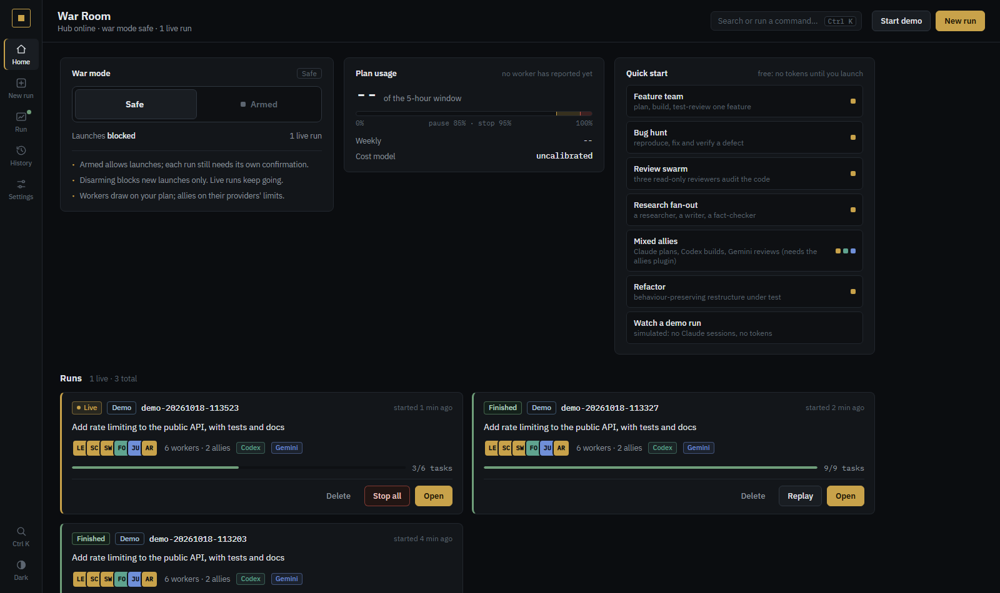
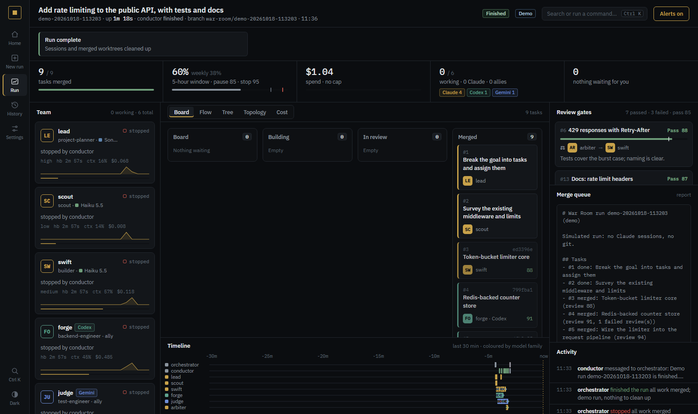
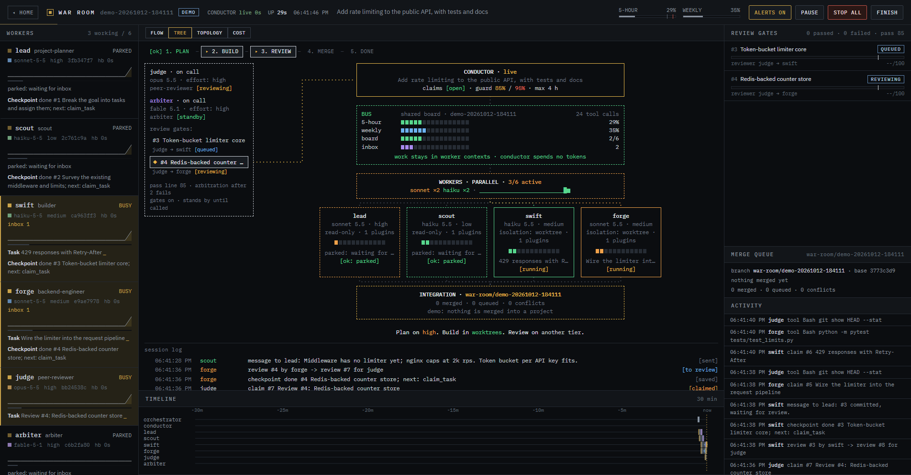
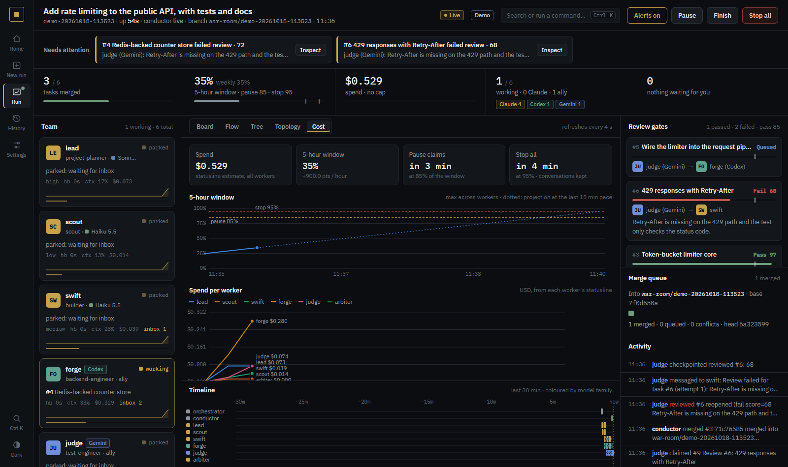
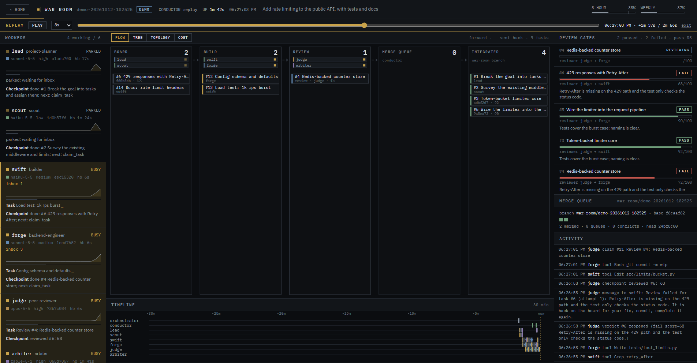
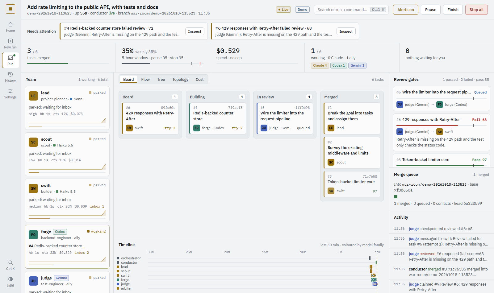

# War Room

Run a team of real, parallel Claude Code workers on one large job. Each worker:

- has a Specialist Council role, with its own model and effort
- loads only the plugins and MCP servers its kind of work needs
- runs unattended on a narrow allow-list

Finished work is reviewed by another worker on a different model before it counts. Approved commits merge into a per-run integration branch. Usage limits are survived by checkpointing and resuming automatically. When the work is done, the run cleans up after itself. A local app shows the whole thing live.

Install with `/plugin install war-room@moaa` (the MOAA installer adds it to both profiles). Design history: [feasibility study](docs/FEASIBILITY.md) and [step-0 spikes](docs/SPIKES.md).













To see the app without spending any tokens, run `python warroom.py demo` (or press **Start demo** on Home). It plays a simulated six-worker run through the real bus for two to three minutes: no Claude session is started.

## The app

`python warroom.py app` opens the War Room as a desktop window. It is a local hub on 127.0.0.1, shown in a chromeless Edge, Chrome or Brave `--app` window with its own profile, so it has no tabs or address bar. The hub serves every run, and you can also reach it with `warroom.py app <run>`.

`python warroom.py app --install-shortcut` adds **War Room** to the Start menu and the desktop on Windows, with its own icon, or a menu entry on Linux. The shortcut runs a small launcher in `~/.claude/war-room/` that opens whichever War Room version is installed, so it survives plugin updates. No console window appears. `--remove-shortcut` takes it away again. War Room stays a MOAA plugin: the app still needs Claude Code and Python.

**Home**

- **New run.** Pick the project folder with **Browse…** (the system folder dialog) or type its path; it must be a folder Claude Code already trusts. Then describe the job and either:
  - **Draft with Claude:** one headless Sonnet call with no tools, no session file and no plugins drafts the plan (about 10–30k tokens of your plan; the app asks first and shows the progress and any error), or
  - **Write by hand:** an empty form with a planner, a builder and a reviewer, at no token cost.

  Both open the plan editor: name, goal, workers (council role, model, effort, brief) and seed tasks (assignee, review on or off). The budget comes from Settings. **Create plan** resolves roles and plugins exactly like `warroom.py plan` and opens **Preview & launch**; nothing starts until you arm war mode, acknowledge and launch. The draft survives a reload.
- **War mode master switch.** Arming it opens a warning, the live plan meter and an acknowledgement. While the switch is SAFE, launches are blocked.
- **Settings.** These are the defaults for every new plan:
  - max workers
  - usage guard pause and stop thresholds, shown on a gauge with the live meter marked
  - max run length
  - review gates: on/off, pass score, failed reviews before arbitration
  - keep-alive wait
  - auto finish and auto integrate

  Values are validated, and the built-in defaults can be restored. **Presets** save the current settings under a name and apply them later. **Alerts** switch the desktop notification and sound on or off.
- **Worker profiles.** The plugins each worker kind loads (planner, builder, reviewer), and a default model tier and effort per Specialist Council role. Changes apply to new plans and are kept in `~/.claude/war-room/profiles.json` and `config.json`. Allow and deny lists are never changed here, but a plugin brings its own hooks and MCP servers, so add only plugins you trust for that kind of worker. A plan that names a model still wins.
- **History** (header link): finished and stopped runs with outcome, review results, measured tokens, statusline spend and the report. Runs can be deleted there.
- **Start demo** (header): opens a simulated run.
- **Replay** on a finished or stopped run card (and on History) opens the run view in replay mode.
- **Theme** (Settings → Alerts): graphite dark (the default), light, or follow the system. The Tree tab stays dark in the light theme, as a terminal pane would. `?theme=light` on any page previews a theme without saving it.
- **Runs.** Every run with its status, goal, roster (tier swatch, worker, council role) and progress. A planned run has **Preview & launch**, which shows the roster, plugins, calibrated token estimate, guard, gates and warning, then an acknowledgement, then a launch sequence before it hands over to the run view.

**Run view**

- **Flow** (default tab): a live view of the workflow. Five stations (Board → Build → Review → Merge queue → Integrated) are linked by moving conveyor belts. Each task is a persistent block that glides between stations. A forward move leaves an amber trail, and a failed review sends it back with a red trail. Each station lists the workers on it, with status lights. Below 640 px wide the view switches to rows.
- **Tree** tab: the run as a terminal-style agent tree. A stepper marks the phases (plan, build, review, merge, done). A reviewer rail on the left lists the reviewers on call and the latest gates, and the gate under review is wired to the conductor. Below the conductor sit the bus (5-hour, weekly, board and inbox block meters), the workers fanned out in boxes coloured by model tier, and the integration branch. A session log and a status line close it off.
- **Cost** tab: total spend, the 5-hour window with its burn rate and a dotted projection to the pause and stop thresholds, spend per worker over time with a crosshair, a per-worker table (share, burn per minute, context), and the measured runs behind the cost model.
- **Worker drill-down:** click a worker card (or its box in the Tree) for its recent tool calls with a histogram, messages, checkpoints, tasks and context and spend charts. **Focus console** raises the worker's console, opening one if it has none; **Copy attach command** copies `claude attach <session>`.
- **Alerts:** a toast when a human gate opens or the run stops or finishes, plus a desktop notification and two beeps when Alerts is on.
- **Replay** (`/run/<run>?replay=1`, or Replay on History and Home): the run rebuilt from its full logs at any moment and played through the same panels, with play and pause, 1x to 120x speed and a scrubber. Tasks, reviews, merges, workers, inbox counts, checkpoints, meters and usage are all as they stood at that moment, and moving the scrubber back works too. `&at=0.5` opens it halfway through.
- **Topology** tab: who talks to whom. Messages travel along the edges as packets. A newly launched worker's node draws itself in while a deploy line runs from the orchestrator.
- **Boot sequence:** a launching or resumed worker's card slides in and steps through SPAWN → PROFILE → PLUGINS n → BUS → READY. READY is reached only when the worker has really started. While workers boot, a fleet boot panel in the Flow view shows them all together.
- **Workers:** each card shows a status light (busy, parked, booting, stopped), model, effort, ticking heartbeat, inbox count, a 20-minute activity sparkline, context use, current task and last checkpoint.
- **Review gates:** every verdict, with a score bar against the pass line, PASS, FAIL or REVIEWING, reviewer → author, and the notes.
- **Merge queue**, a scrolling 30-minute timeline, and an activity feed. When the run finishes, the merge queue panel shows the report.
- **Header:** conductor pulse, uptime, plan meters with threshold ticks, and Pause, Stop all, Finish, Resume and Integrate (each shown when it applies). A banner reports stopped, paused, human-gate, finishing-countdown and complete states.

The visual style is flat graphite, hairline borders, IBM Plex and muted model-tier colours, with no gradients, glow or pills. The Tree tab uses a brighter terminal palette, and the Cost charts use a categorical palette checked for colour-blind separation. Motion is mechanical (stepped lights, marching dashes, belts) and is switched off under reduced-motion settings.

## Command line

```
python warroom.py toggle on|off|status
python warroom.py plan plan.json                  # preview: roles, models, curated plugins, calibrated estimate, warning
python warroom.py launch <run> --confirm <code>   # or Preview & launch in the app
python warroom.py app [<run>] [--quit]
python warroom.py app --install-shortcut          # Start-menu and desktop shortcuts (Windows) or a menu entry (Linux)
python warroom.py demo [--speed N]                # a simulated run in the app: no Claude sessions, no tokens
python warroom.py status <run> [--json]
python warroom.py post <run> "title" --detail "..." [--to worker]
python warroom.py send <run> <worker> "message"
python warroom.py wake <run> <worker> ["message"]
python warroom.py approve <run> <task> [--reject "notes"]   # human gate for blocked tasks
python warroom.py merge <run>                     # process the merge queue now
python warroom.py integrate <run> [--apply]       # report, or merge the run branch into the current branch (no push)
python warroom.py pause|unpause|stop|resume <run>
python warroom.py finish <run> / shutdown <run>   # finish: stop, measure, clean up; shutdown also closes the window
python warroom.py measure <run>                   # record real token use (calibrates estimates)
python warroom.py watch <run> [--schedule]        # the conductor (normally a background daemon)
python warroom.py tile <run> / restart-daemons <run> [--open] / list
```

## How it works

- **Workers** are `claude --bg` sessions. They are launched with:
  - `--model` and `--effort` from `council.py resolve`, or set in the plan
  - `--setting-sources project,local` and `--strict-mcp-config`, so user plugins and MCP servers are not loaded
  - `--plugin-dir` for each plugin of the worker's kind
  - `--mcp-config` with the bus plus any tagged servers
  - `--settings` with allow and deny lists, hooks and statusLine
  - `--worktree` for writers; `--add-dir` to the worktrees folder for readers
  - `--append-system-prompt` with the protocol

  The prompt goes after a `--` separator, because variadic flags would otherwise swallow it.
- **Curated plugins** come from `profiles.json`: planners and builders get specialist-council, reviewers get specialist-council and agent-arena-mode, and a plan can add plugins or tag MCP servers per worker. A slim worker starts at about 42k tokens of context, against about 130k with every user plugin.
- **Bus** (`bus.py`): SQLite in WAL mode, served to each worker as a stdlib MCP server.
  - Tools: `post_task`, `claim_task`, `complete_task`, `verdict`, `send`, `inbox`, `heartbeat`, `checkpoint`, `last_checkpoint`, `board`.
  - Claims are atomic.
  - Older runs gain new columns automatically when opened.
- **Review gates:**
  - A writer must commit and pass the hash to `complete_task`. The task goes to `review`, and the bus creates a review task for a reviewer worker on a different model tier, falling back to the human when there is none.
  - `verdict` passes only at or above the pass score (default 85). A fail reopens the task for its author with the notes; re-submitting claims it again automatically.
  - After `max_fails` failures an `arbiter` worker decides, then you (`approve`). Nobody can review their own work.
- **Merge queue:** the conductor merges approved commits `--no-ff`, oldest approval first, into `war-room/<run>`. That branch lives in its own worktree and is based on the commit the writers' worktrees start from (`claude --worktree` branches from the default branch). A conflict aborts the merge and sends the task back with instructions.
- **Finishing:**
  - When all work is merged, nothing is open or under review, and every worker is parked for 90 s, the conductor finishes the run. It stops the workers, records the measured cost, and writes `report.md`.
  - It then unlocks and removes writer worktrees that are clean and fully merged (deleting their branches), removes the integration worktree (keeping the branch if it holds commits), and deletes every session the run used.
  - Sessions must be deleted because resuming a stopped background session forks a copy in Claude Code 2.1.296, so old copies pile up. Worktrees are cleaned first because `claude rm` keeps a session while its worktree exists.
  - Unreviewed or uncommitted work is kept and reported, never deleted.
  - Integration into your branch is the Integrate button or `integrate --apply` (clean tree only, `--no-ff`, never pushed). `auto_integrate` does it automatically.
- **Waking a worker:**
  - (1) A parked worker wakes on a bus message (the Stop hook long-polls at no token cost).
  - (2) An idle worker is restarted with its stored flags and `--resume`, or relaunched fresh if it never finished a turn; the conductor does this automatically when work is waiting.
  - (3) The orchestrator session can message a worker natively with `SendMessage`.
- **Usage limits:**
  - Every worker reports `rate_limits` through its statusLine.
  - At the pause threshold, claims pause (a manual pause is never lifted by the guard).
  - At the stop threshold, or on a "hit your limit" message, every worker stops with its conversation kept, and auto-resumes at the real reset time plus 2 minutes. `--schedule` also registers an OS task, so the resume survives a reboot.
  - The SessionStart hook restores checkpoints and claimed tasks after a resume.
- **Cost model:** `measure` sums token use from transcripts, deduplicated across resumed copies. `plan` estimates from the median measured cost per worker per task.
- **Tiling:**
  - Windows: one `conhost` console per worker running `claude attach`, so a hang stays local. The conductor writes each worker's state into its console's title (`swift · working · War Room`: working, waiting, idle, stopped or done). Claude Code reports the same states through the Program Status Protocol (OSC 7501) to terminals that support it, and conhost does not. The consoles start with `CLAUDE_CODE_DISABLE_TERMINAL_TITLE=1`, so Claude Code's own title spinner never overwrites the status. The dashboard app takes the left 56% of the primary screen and the consoles grid on the right, with the last row stretching. Placement uses asynchronous `SetWindowPos`. The conductor reopens any console that is missing.
  - macOS / Linux: a tiled tmux session in a Terminal window (checked live on Linux with tmux 3.4; the macOS Terminal launch is untested).
  - Workers retry an overloaded API (HTTP 529) with a longer backoff (`CLAUDE_CODE_OVERLOADED_RETRY_BASE_DELAY_MS` 5 s, `..._MAX_DELAY_MS` 5 min) rather than fail a turn while unattended.
- **Safety:**
  - Workers run in `dontAsk` mode with allow-lists. Push, publish, branch and tag deletion, `rm -rf` and web access are denied.
  - The hub listens only on 127.0.0.1. Every POST needs a per-start token embedded in the page.
  - Home paths are redacted.
  - `plan` refuses repositories Claude Code doesn't trust yet; War Room never bypasses the trust prompt.

## Verified live (2026-10-12)

| Check | Result |
|---|---|
| End-to-end job | Planner → builder (own worktree, commits) → reviewer (different tier) → merged, no human input |
| Gates with failure and recovery | Both build tasks failed review at 70 (house-rule docstrings), were fixed, re-reviewed and passed at 93–95, then merged |
| Merge queue | Approved commits merged in order into `war-room/<run>`; conflict handling covered by a real-git unit test |
| Auto finish | Fired 90 s after completion: stopped, measured (2.96M and 3.95M tokens), cleaned sessions and merged worktrees, and kept an unreviewed extra commit with a report |
| Launch from the app | Preview → acknowledge → launch sequence → run view: workers booted, tasks flowed live, then auto finish |
| Wake paths | Parked (bus, 6 s), idle (resume, 8 s, recalled its commit from memory), native `SendMessage`, conductor auto-wake |
| Long keep-alive | Parked 13+ minutes on a 1560 s hook, then woke in 6 s |
| Usage guard | Stop at the threshold, `resume_at` = real reset + 2 min, auto-resume with context |
| Tiling | Dashboard app plus 3 consoles laid out on 1920x1032; restarted workers re-enter the layout; the conductor self-heals missing consoles |

## Tests

```
python -m unittest discover -s tests   # policy, argv replay, plan curation, hooks, gates, arbitration, merge queue (real git),
                                       # finish, cleanup, integrate, layout, tmux plan, calibration, migration
python tests/test_bus.py               # 3 MCP server processes, 300 contended claims, exactly-once delivery
```

## Known limits

- **Resume makes a copy.** Resuming a stopped background session always forks a copy under a new ID (Claude Code 2.1.296 behaviour). The conductor tracks the copy, and finishing deletes them all.
- **macOS tiling** opens the tmux session through Terminal via `osascript`; the tmux part is checked on Linux, the Terminal launch is untested.
- **The cost model** is calibrated on small Haiku/Sonnet runs, so expect larger jobs to differ until they have been measured.
- **The app window** needs Edge, Chrome or Brave; otherwise War Room opens in the default browser.
